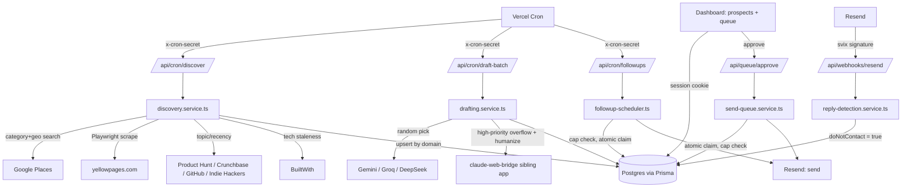
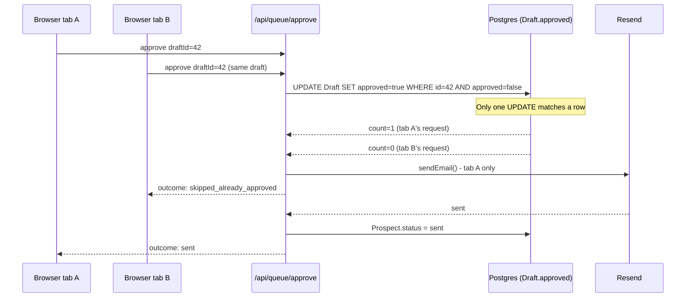

<div align="center">
  
  <h1>
    Biz Scraper <sup><sub>v0.0.1</sub></sup>
  </h1>
  <p>
    <em>Finds companies whose own website reveals technical debt, drafts the outreach, and refuses to send anything a human hasn't approved.</em>
  </p>
  <br />

  
  
  
  
  
</div>

## Contents

- [Pitch](#pitch)
- [Features](#features)
- [Demo](#demo)
- [How It Works](#how-it-works)
- [Tech Stack](#tech-stack)
- [Getting Started](#getting-started)
- [Configuration](#configuration)
- [API / Usage](#api--usage)
- [Roadmap](#roadmap)
- [License](#license)

## Pitch

Cold outreach usually means either buying a static list or paying per-lookup for "intent data" that's really just a keyword match. Biz Scraper instead scores a company by what its own public surface already reveals - an unencrypted site, a stack that hasn't shipped in years, a funding round, a hiring post for a role the company can't yet support - and treats that as the one legitimate signal worth writing an email about.

Discovery runs across two branches: local/SMB sources (Google Places, a Playwright-driven yellowpages.com scrape) and startup/SaaS sources (Product Hunt, Crunchbase, GitHub, Indie Hackers), with BuiltWith layered on top as a tech-staleness enrichment pass. Contact enrichment falls back from Hunter.io to People Data Labs when the free-tier quota runs out. Drafting samples three distinct copywriting frameworks per prospect from a swappable provider registry - Gemini, Groq, and DeepSeek rotated at random - with a local claude-web-bridge sibling app as a scarce tier-2 fallback and humanizer pass for high-priority leads only.

The interesting tradeoff is where the system refuses to be clever: nothing sends without a human clicking approve, the outbound daily cap is a zero-argument function no caller can pass a bypass into, and the approval path uses a single conditional `UPDATE ... WHERE approved = false` as the only concurrency guard against a double-send - no distributed lock, no `SELECT FOR UPDATE`, just Postgres's own atomicity. Every external key is optional and every source degrades to "unavailable, skipped" rather than crashing a run; only four environment variables are actually required to boot.

Built for a single operator running their own outbound pipeline, not a multi-tenant SaaS - the dashboard sits behind one shared password, by design, for now.

## Features

**Discovery**

**Branch A / B source registry** - Google Places + yellowpages.com (local/SMB) and Product Hunt + Crunchbase + GitHub + Indie Hackers (startup/SaaS) run behind one orchestrator; a missing API key degrades a source to `unavailable`, not a failed run.

**BuiltWith tech-staleness enrichment** - layers a stronger signal onto an already-discovered prospect only when it outranks what the source itself found.

**SSRF-safe signal detection** - every prospect-supplied website URL, and every redirect hop it produces, is revalidated against a private/loopback/link-local/cloud-metadata IP blocklist before being fetched.

**Domain-based dedup with a do-not-contact floor** - re-discovering an already-opted-out prospect never resurrects it into the pipeline.

**Enrichment**

**Hunter → People Data Labs fallback** - contact/email finding with the free-tier call count tracked in Postgres so it stops calling before Hunter's monthly cap is exceeded rather than after.

**Drafting**

**Multi-provider rotation** - Gemini, Groq, and DeepSeek registered behind one interface; a random pick (not round-robin) survives Vercel's serverless cold starts, where in-memory rotation state doesn't.

**Framework sampling** - three variants per prospect, each a distinct copywriting framework sampled without replacement, so no prospect gets the same angle twice.

**claude-web-bridge tier-2 overflow** - a scarce, shared ~40-message/8-hour budget reserved for high-priority prospects only, skipped outright when a known cooldown is already recorded.

**Post-generation validation with one retry** - word count and banned-phrase checks the prompt can't enforce on its own; a non-compliant draft gets one retry through the rotation before the prospect is flagged instead of persisted.

**Approval Queue & Send**

**Atomic anti-double-send claim** - one conditional `UPDATE` is the sole concurrency guard between two browser tabs, a double-click, or a network retry approving the same draft.

**Domain-verification gate** - real send volume stays capped at a test ceiling until a human flips `DOMAIN_DNS_VERIFIED` after actually confirming SPF/DKIM/DMARC; no code path can request a bypass.

**Follow-ups & Reply Handling**

**4-touch follow-up scheduler** - stale-by-interval eligibility, auto-`dead` after the 4th unanswered touch, and a reply-vs-follow-up race closed by the same atomic-claim pattern the send path uses.

**Verified inbound webhook** - Resend/Svix HMAC-verified before a reply can flip a prospect's `doNotContact` flag; unverified events are rejected outright, not just ignored.

**Dashboard**

**Shared-password session auth** - HMAC-signed cookie, constant-time compare, deny-by-default `proxy.ts` gate on every route except login and the Resend webhook.

**Prospects & approval queue tables** - TanStack Table-backed views for triaging discovered prospects and approving/editing drafts before send.

## Demo


_The prospects dashboard - every discovered lead with its signal, priority score, and pipeline status in one sortable table._


_The approval queue - the one screen in the app that can actually cause an email to leave the system, and the only one that can._

## How It Works





**Key Decisions**

- **Random provider rotation over round-robin index**: a stateless random pick across Gemini/Groq/DeepSeek over an in-memory rotation counter, because this app runs on Vercel serverless - module-level state doesn't survive a cold start, so an index-based rotation would silently stop rotating fairly.
- **Single conditional `UPDATE` over a distributed lock**: `updateMany({ where: { approved: false }, data: { approved: true } })` as the only concurrency guard on send, over `SELECT FOR UPDATE` or an app-level mutex, because Postgres already guarantees exactly one caller's `UPDATE` matches the row - no extra locking primitive changes that guarantee, it only adds one more thing to get wrong.
- **Zero-argument daily-cap function over a configurable parameter**: `getEffectiveDailyCap()` takes no arguments, so no caller - not even by accident - can pass through a higher cap before `DOMAIN_DNS_VERIFIED` is flipped by a human who actually checked DNS.
- **Plain nullable string over a Prisma enum for `Draft.framework`**: a copywriting framework registry is meant to grow by adding one file, not by opening a migration every time; an enum column would force exactly the ceremony the registry pattern exists to avoid.
- **JSON columns for `location`/`signal`/`statusHistory` over normalized tables**: no query pattern in this app filters or joins on their internal fields, so normalizing them would add joins that pay for themselves never.
- **Per-redirect-hop SSRF revalidation over a one-time URL check**: a scraped listing's website field is attacker-writable, and a single upfront check would miss a safe URL that redirects to `169.254.169.254` - every hop up to `MAX_REDIRECTS` is re-validated against the same private/loopback/link-local blocklist.

## Tech Stack

| Technology | Role | Why |
| --- | --- | --- |
| Next.js 16 | App Router: dashboard, API routes, cron endpoints | Route-based middleware is now `proxy.ts`/`proxy()`, not `middleware.ts` - a Next 16 convention change, not a project quirk |
| TypeScript | Language, `strict: true` | - |
| Prisma 7 + `@prisma/adapter-pg` | ORM, migrations | Prisma 7 requires a driver adapter instead of a bare datasource URL |
| PostgreSQL (Neon) | Primary datastore | Hosted, no local DB to run or maintain |
| Playwright | yellowpages.com scraping, website signal detection | Needs real DOM rendering; the sources it replaced (a standalone BeautifulSoup script) couldn't handle JS-rendered listings |
| Zod 4 | Env validation, request/webhook schema parsing | Fails the app at boot on a malformed env var instead of at first use |
| Radix UI / shadcn, TanStack Table | Dashboard components, prospects/queue tables | - |
| Resend | Outbound send + inbound reply webhook | Svix-signed webhooks map directly onto the fail-closed verification this app already requires everywhere else |
| Gemini / Groq / DeepSeek | Stage 2 drafting rotation pool | Free-tier keys, registered behind one swappable interface so adding a fourth provider is one file, not a rewrite |
| claude-web-bridge (sibling app) | Tier-2 drafting overflow + humanizer | A locally-run headless Claude web session, not an API call - shares one ~40-msg/8h budget across every caller |
| Vitest | Test runner | 563 tests across 50 files as of this writing |

## Getting Started

### Prerequisites

- Node.js ≥ 20
- npm
- A [Neon](https://neon.tech) account (free tier is fine) - create a project and grab its connection string

### One command

```powershell
./setup.ps1
```

This creates `.env` with fresh secrets (you still need to paste in your Neon connection string), installs dependencies, generates the Prisma client, runs migrations against your Neon database, and runs the test suite. See what it does below if you'd rather run the steps yourself.

### Manual steps

```bash
git clone <this-repo-url>
cd biz-scraper
npm install
cp .env.example .env
# fill in DATABASE_URL (your Neon connection string), plus
# SESSION_SECRET, CRON_SECRET at minimum - see Configuration below
npx prisma generate
npx prisma migrate deploy
npm run dev
```

Dashboard is at http://localhost:3000 (redirects to `/login`). Before the first login, provision
the two fixed accounts (Noel / EvilWithin) once:

```bash
curl -X POST https://<your-deployment>/api/cron/seed-users -H "x-cron-secret: <CRON_SECRET>"
```

Each account sets its own password (min 8 characters) the first time it signs in at `/login` -
there is no registration form, and no other nickname is ever accepted.

### Test

```bash
npm test        # unit/integration suite (vitest run)
npm run test:watch
npm run typecheck
npm run lint
```

## Configuration

Only three variables are required to boot the app. Everything else is a discovery/enrichment/drafting/sending source that degrades to "unavailable, skipped" when unset - fill them in as you provision each service.

| Variable | Required | Default | Description |
| --- | --- | --- | --- |
| `DATABASE_URL` | Yes | - | Postgres connection string (Neon) - also used by the test suite, so a handful of test files write/delete real rows here |
| `SESSION_SECRET` | Yes | - | ≥32 chars; signs the dashboard session cookie (no shared password anymore - see the two-account auth system below) |
| `CRON_SECRET` | Yes | - | ≥32 chars; required in the `x-cron-secret` header on every cron route |
| `GOOGLE_PLACES_API_KEY` | No | - | Branch A discovery: category+geography search |
| `BUILTWITH_API_KEY` | No | - | Tech-stack staleness enrichment |
| `PRODUCT_HUNT_API_TOKEN` | No | - | Branch B discovery: recently-launched products |
| `CRUNCHBASE_API_KEY` | No | - | Branch B discovery: recently-funded startups |
| `GITHUB_TOKEN` | No | - | Branch B discovery: hiring/CI-gap signals; unauthenticated GitHub calls still work at a lower rate limit |
| `HUNTER_API_KEY` | No | - | Branch C contact enrichment; free tier capped at a monthly search quota (50 as of this writing, see `hunter.source.ts`), tracked in `ApiUsageCounter` |
| `PEOPLE_DATA_LABS_API_KEY` | No | - | Branch C fallback when Hunter is unavailable or exhausted |
| `GEMINI_API_KEY` | No | - | Drafting rotation pool; comma-separated list rotates across keys |
| `GROQ_API_KEY` | No | - | Drafting rotation pool; same comma-separated pattern |
| `DEEPSEEK_API_KEY` | No | - | Drafting rotation pool; same comma-separated pattern |
| `CLAUDE_BRIDGE_URL` | No | `http://127.0.0.1:3000` | Base URL of the local claude-web-bridge sibling app |
| `CLAUDE_BRIDGE_API_KEY` | No | - | Bearer token for the bridge's own optional auth |
| `RESEND_API_KEY` | No | - | Required to actually send email via Resend; unset sends degrade to a typed failure |
| `SENDING_DOMAIN` | No | - | Outbound `from` domain (`outreach@$SENDING_DOMAIN`) |
| `DOMAIN_DNS_VERIFIED` | No | `false` | Set to exactly `"true"` once SPF/DKIM/DMARC are verified - THE hard gate on real send volume |
| `DAILY_SEND_CAP_TEST` | No | `3` | Daily send cap enforced only while `DOMAIN_DNS_VERIFIED` isn't `"true"` |
| `DOMAIN_WARMUP_START_DATE` | No | - | ISO date; feeds the post-verification warmup ramp |
| `RESEND_WEBHOOK_SECRET` | No* | - | Svix signing secret for the inbound reply webhook. *Unlike the other optional keys, leaving this unset doesn't skip verification - it makes the webhook route reject every event outright (fail closed) |

## API / Usage

`POST /api/login` - Body: `{ password }`. Sets the signed session cookie on success.

`POST /api/cron/discover` - Header: `x-cron-secret`. Body: `{ category, geography, branch?: "a" | "b" | "both" }`. Runs discovery sources for the requested branch and persists results.

`POST /api/cron/draft-batch` - Header: `x-cron-secret`. Drafts a bounded batch of `enriched`-status prospects, then runs the humanizer pass on previously-drafted prospects missing one.

`POST /api/cron/followups` - Header: `x-cron-secret`. Sends the next due follow-up touch for stale `sent`/`followup_*` prospects, or marks unanswered `followup_3` prospects `dead`.

`POST /api/queue/approve` - Body: `{ items: [{ draftId, editedBody? }] }`. The only route in the app that can cause an email to leave the system.

`POST /api/webhooks/resend` - Verifies a Svix signature, then maps an inbound reply to `doNotContact`/`replied` on the matching prospect.

## Roadmap

| Status | Item |
| --- | --- |
| ✅ | Branch A + Branch B discovery, BuiltWith enrichment |
| ✅ | Hunter → People Data Labs contact enrichment with quota tracking |
| ✅ | Multi-provider drafting rotation + claude-bridge tier-2 overflow + humanizer |
| ✅ | Approval queue with atomic anti-double-send guarantee |
| ✅ | 4-touch follow-up scheduler + verified reply webhook |
| 🔲 | Real weighted priority scoring - currently a stub scored on signal strength alone; the discovery service's own comments flag this as the next real phase |
| 🔲 | `yellowpages` as a first-class `ProspectSource` enum value - currently mapped to `manual` since it isn't one of the spec's three official Branch A sources |
| 🔲 | Per-touch follow-up spacing - currently one fixed 4-day interval for every touch |

## License

MIT © 2026 yassine krichen

---

Built by [yassine krichen](https://github.com/) · 2026

## Before You Publish

- [ ] Add `docs/cover.png` - generate with: *"Biz Scraper - a dark, high-contrast dashboard showing a sortable prospects table with signal badges (outdated site, no HTTPS, funding event) and priority scores. Professional software screenshot aesthetic. Wide banner format, 1400×600px. No people. No text overlays."* in Midjourney or DALL-E, then commit it.
- [ ] Add real screenshots to `docs/demo/prospects.png` and `docs/demo/queue.png` - referenced in the Demo section above.
- [ ] Add a `LICENSE` file at the repo root - full text below, chosen as MIT since this is a single-author project with no `CONTRIBUTORS` file or multi-owner signal.
- [ ] Delete `yellowpages_scraper.py` and `venv/` - a tracked leftover from the original Python/BeautifulSoup prototype that `src/features/discovery/sources/yellowpages.source.ts` already fully replaced (see that file's own doc comment). Keeping a dead, unreferenced scraper script in a TypeScript project reads as unfinished cleanup to anyone skimming the tree.
- [ ] Fix the footer's GitHub link - `https://github.com/` is a placeholder; point it at your actual profile.

<details>
<summary>LICENSE (MIT) - click to expand</summary>
 
```
MIT License

Copyright (c) 2026 yassine krichen

Permission is hereby granted, free of charge, to any person obtaining a copy
of this software and associated documentation files (the "Software"), to deal
in the Software without restriction, including without limitation the rights
to use, copy, modify, merge, publish, distribute, sublicense, and/or sell
copies of the Software, and to permit persons to whom the Software is
furnished to do so, subject to the following conditions:

The above copyright notice and this permission notice shall be included in all
copies or substantial portions of the Software.

THE SOFTWARE IS PROVIDED "AS IS", WITHOUT WARRANTY OF ANY KIND, EXPRESS OR
IMPLIED, INCLUDING BUT NOT LIMITED TO THE WARRANTIES OF MERCHANTABILITY,
FITNESS FOR A PARTICULAR PURPOSE AND NONINFRINGEMENT. IN NO EVENT SHALL THE
AUTHORS OR COPYRIGHT HOLDERS BE LIABLE FOR ANY CLAIM, DAMAGES OR OTHER
LIABILITY, WHETHER IN AN ACTION OF CONTRACT, TORT OR OTHERWISE, ARISING FROM,
OUT OF OR IN CONNECTION WITH THE SOFTWARE OR THE USE OR OTHER DEALINGS IN THE
SOFTWARE.
```

</details>
