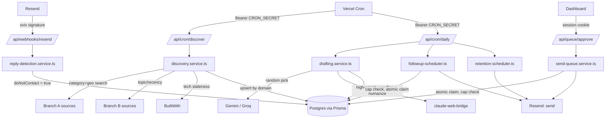
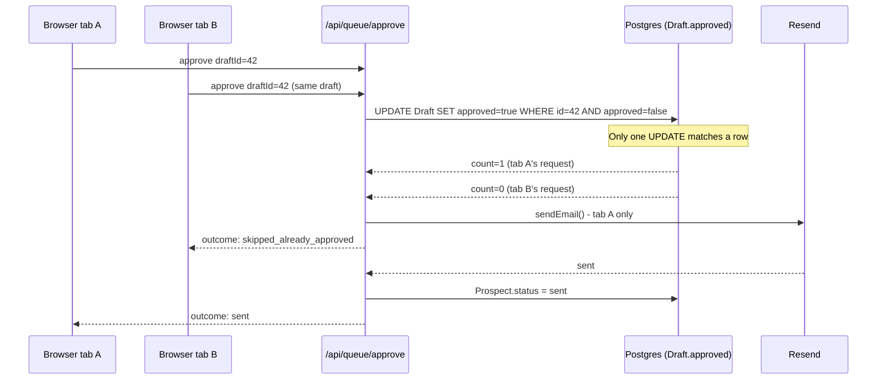

<div align="center">
  <h1>
    Prospectra <sup><sub>v0.0.1</sub></sup>
  </h1>
  <p>
    <em>Finds companies whose own website reveals technical debt, drafts the outreach, and refuses to send anything a human hasn't approved.</em>
  </p>
  <p>(repo: biz-scraper)</p>

  
  
  
  
  
</div>

## Contents

- [Pitch](#pitch)
- [Features](#features)
- [How It Works](#how-it-works)
- [Tech Stack](#tech-stack)
- [Getting Started](#getting-started)
- [Testing](#testing)
- [Configuration](#configuration)
- [API / Usage](#api--usage)
- [Roadmap](#roadmap)
- [License](#license)
- [Still Open](#still-open)

## Pitch

Cold outreach usually means buying a static list or paying per lookup for "intent data" that is really a keyword match. Prospectra scores a company by what its own public surface already reveals: an unencrypted site, a stack that has not shipped in years, a funding round, a hiring post for a role the company cannot yet support. That signal is the one worth writing an email about.

Discovery runs two branches. Branch A covers local and SMB sources (Google Places, a Playwright-driven yellowpages.com scrape, Overpass, Companies House, Texas Comptroller). Branch B covers startup and SaaS sources (Product Hunt, Crunchbase, GitHub, Indie Hackers). BuiltWith layers a tech-staleness pass on top. Contact enrichment tries Hunter.io and falls back to People Data Labs. Drafting samples three copywriting frameworks per prospect from a provider registry (Gemini and Groq, picked at random), with a local claude-web-bridge app as a scarce tier-2 overflow for high-priority leads.

The tradeoffs sit where the system refuses to be clever. Nothing sends without a human clicking approve. The daily send cap is a zero-argument function, so no caller can pass a bypass. The approval path uses a single conditional `UPDATE ... WHERE approved = false` as its only guard against a double send: no distributed lock, no `SELECT FOR UPDATE`. Every external key is optional and every source degrades to "unavailable, skipped" instead of failing a run.

Built for a single operator running their own outbound pipeline, not a multi-tenant SaaS. Two fixed accounts, no registration.

## Features

**Discovery**

**Branch A / B source registry** - one orchestrator over every source, driven by `discovery-source-registry.ts`; a missing API key marks a source `unavailable` instead of failing the run.

**BuiltWith tech-staleness enrichment** - applies a stronger signal to an already-discovered prospect only when it outranks what the source itself found.

**SSRF-safe signal detection** - every prospect-supplied website URL, and every redirect hop it produces, is revalidated against a private/loopback/link-local/cloud-metadata blocklist before being fetched.

**Domain-based dedup with a do-not-contact floor** - re-discovering an opted-out prospect never puts it back in the pipeline.

**Scheduled discovery** - a daily Vercel cron cycles a fixed New York category list by UTC date, with no persisted "last run" pointer.

**Enrichment**

**Hunter to People Data Labs fallback** - free-tier call counts live in Postgres (`ApiUsageCounter`) so calls stop before the monthly cap, not after.

**Drafting**

**Provider rotation** - Gemini and Groq sit behind one interface; a random pick survives serverless cold starts, where in-memory rotation state does not.

**Framework sampling** - three variants per prospect, each a distinct copywriting framework.

**claude-web-bridge tier-2 overflow** - a shared message budget reserved for high-priority prospects, skipped when a cooldown is recorded (`BridgeCooldown`).

**Post-generation validation with one retry** - word-count and banned-phrase checks the prompt cannot enforce; a non-compliant draft gets one retry before the prospect is flagged.

**Weighted priority scoring** - `priority-scoring.ts` ranks prospects by signal strength, company size and market, with tunable weights.

**Approval Queue and Send**

**Atomic anti-double-send claim** - one conditional `UPDATE` guards against two tabs, a double click, or a network retry approving the same draft.

**Domain-verification gate** - sends stay capped at `DAILY_SEND_CAP_TEST` until a human sets `DOMAIN_DNS_VERIFIED=true` after confirming SPF/DKIM/DMARC.

**Follow-ups, Reply Handling and Retention**

**4-touch follow-up scheduler** - stale-by-interval eligibility, auto-`dead` after the fourth unanswered touch, and the same atomic-claim pattern on the reply-vs-follow-up race.

**Verified inbound webhook** - Resend/Svix signature checked before a reply can set `doNotContact`; unverified events are rejected.

**Client conversion and retention** - a replied or won prospect converts to a `Client` with `Job`s, and the retention scheduler sends touches on delivered or active jobs.

**Dashboard and Auth**

**Two-account session auth** - scrypt password hashes, HMAC-signed session cookie, 5-failure / 15-minute lockout, and a deny-by-default `proxy.ts` gate.

**Operator views** - prospects, approval queue (all draft variants side by side), clients, discovery with run history, and pipeline pages.

## How It Works





**Key Decisions**

- **Random provider rotation**: a stateless random pick across the provider pool over an in-memory round-robin index, because this app runs on Vercel serverless and module-level state does not survive a cold start.
- **Single conditional `UPDATE`**: `updateMany({ where: { approved: false }, ... })` as the only send guard over `SELECT FOR UPDATE` or an app-level mutex, because Postgres already guarantees one caller's `UPDATE` matches the row.
- **Zero-argument daily cap**: `getEffectiveDailyCap()` takes no parameters over a configurable cap, so no caller can pass a higher number before `DOMAIN_DNS_VERIFIED` is flipped by a human.
- **Plain nullable string for `Draft.framework`**: a string over a Prisma enum, because the framework registry grows by adding a file and an enum would force a migration each time.
- **Per-redirect-hop SSRF revalidation**: every hop up to `MAX_REDIRECTS` is checked against the blocklist over a one-time URL check, because a scraped website field is attacker-writable and a safe URL can redirect to `169.254.169.254`.
- **Separate session-gated and cron-secret routes**: `/api/pipeline/*` (session) and `/api/cron/*` (secret) call the same services, so the browser never handles the cron secret.

## Tech Stack

| Technology | Role | Why |
| --- | --- | --- |
| Next.js 16 | App Router: dashboard, API routes, cron endpoints | Route gating lives in `proxy.ts`, the Next 16 replacement for `middleware.ts` |
| TypeScript | Language, `strict: true` | - |
| Prisma 7 + `@prisma/adapter-pg` | ORM, migrations | Prisma 7 requires a driver adapter |
| PostgreSQL (Neon) | Primary datastore | Hosted; no local database to run |
| playwright-core + `@sparticuz/chromium` | Scraping and signal detection | Vercel functions ship no Chromium; the Lambda-compiled build fits a function bundle |
| Zod 4 | Env validation, request and webhook parsing | Fails at boot on a malformed env var |
| Radix UI / shadcn, TanStack Table | Dashboard components and tables | - |
| Resend | Outbound send, inbound reply webhook | Svix-signed webhooks fit the fail-closed verification used elsewhere |
| Gemini / Groq | Drafting rotation pool | Free-tier keys behind one interface; a new provider is one client file |
| claude-web-bridge (sibling app) | Tier-2 drafting overflow and humanizer | A locally run Claude web session, not an API call |
| Vitest | Test runner | See Testing |

## Getting Started

### Prerequisites

- Node.js >= 22.17.0 (the `engines` field; `@sparticuz/chromium` requires it)
- npm
- A [Neon](https://neon.tech) project (free tier is fine) and its connection string

### One command

```powershell
./setup.ps1
```

Creates `.env` with generated secrets (paste in your Neon connection string first), installs dependencies, generates the Prisma client, migrates the database, and runs the test suite.

### Manual steps

```bash
git clone <this-repo-url>
cd biz-scraper
npm install
cp .env.example .env
# fill in DATABASE_URL, SESSION_SECRET, CRON_SECRET at minimum
npx prisma generate
npx prisma migrate deploy
npm run dev
```

The dashboard is at http://localhost:3000 and redirects to `/login`. Provision the two fixed accounts once:

```bash
curl -X POST http://localhost:3000/api/cron/seed-users \
  -H "x-cron-secret: CRON_SECRET" \
  -H "content-type: application/json" \
  -d '{ "passwords": { "Noel": "PASSWORD_MIN_8", "EvilWithin": "PASSWORD_MIN_8" } }'
```

The route is idempotent, never overwrites an existing account, and skips a nickname that has no valid password. There is no registration form and no other nickname is accepted.

## Testing

```bash
npm test            # vitest run
npm run test:watch
npm run typecheck
npm run lint
```

Measured on 2026-10-19: 1,033 tests passing, 75 skipped, across 116 files.

The skips are deliberate. Seven integration files run table-wide `deleteMany()` against real Postgres, so they refuse to run unless `CONFIRM_DESTRUCTIVE_TESTS=true` is set against a disposable `TEST_DATABASE_URL`. `assertDestructiveTestsAllowed()` also refuses when `TEST_DATABASE_URL` equals `DATABASE_URL`, regardless of the flag. A plain `npm test` skips those files and touches no data. After any schema change, apply it to the test database with `npm run db:migrate:test`.

## Configuration

Three variables are required to boot. Everything else is optional and degrades to "unavailable, skipped" when unset. Schema: `src/common/config/env.ts`.

| Variable | Required | Default | Description |
| --- | --- | --- | --- |
| `DATABASE_URL` | Yes | - | Postgres connection string (Neon) |
| `SESSION_SECRET` | Yes | - | At least 32 chars; signs the session cookie |
| `CRON_SECRET` | Yes | - | At least 32 chars; required on every cron route |
| `TEST_DATABASE_URL` | No | - | Disposable database for the destructive integration tests |
| `GOOGLE_PLACES_API_KEY` | No | - | Branch A category and geography search |
| `BUILTWITH_API_KEY` | No | - | Tech-staleness enrichment |
| `BUILTWITH_MONTHLY_CAP` | No | `100` | Monthly BuiltWith call ceiling |
| `COMPANIES_HOUSE_API_KEY` | No | - | Companies House source |
| `TEXAS_COMPTROLLER_API_KEY` | No | - | Texas Comptroller source |
| `PRODUCT_HUNT_API_TOKEN` | No | - | Branch B recently launched products |
| `CRUNCHBASE_API_KEY` | No | - | Branch B recently funded startups |
| `GITHUB_TOKEN` | No | - | Branch B signals; unauthenticated calls work at a lower rate limit |
| `HUNTER_API_KEY` | No | - | Contact enrichment, tracked against a monthly quota |
| `PEOPLE_DATA_LABS_API_KEY` | No | - | Contact enrichment fallback |
| `PEOPLE_DATA_LABS_MONTHLY_CAP` | No | `100` | Monthly People Data Labs call ceiling |
| `GEMINI_API_KEY` | No | - | Drafting pool; comma-separated list rotates keys |
| `GROQ_API_KEY` | No | - | Drafting pool; same pattern |
| `DEEPSEEK_API_KEY` | No | - | Still parsed; DeepSeek is no longer in the drafting rotation |
| `CLAUDE_BRIDGE_URL` | No | - | Base URL of the claude-web-bridge app |
| `CLAUDE_BRIDGE_API_KEY` | No | - | Bearer token for the bridge |
| `RESEND_API_KEY` | No | - | Required to send; unset sends return a typed failure |
| `SENDING_DOMAIN` | No | - | Outbound `from` domain |
| `DOMAIN_DNS_VERIFIED` | No | `false` | Only the exact string `"true"` lifts the send cap |
| `DAILY_SEND_CAP_TEST` | No | `3` | Daily cap while the domain is unverified |
| `DOMAIN_WARMUP_START_DATE` | No | - | Feeds the post-verification warmup ramp |
| `RESEND_WEBHOOK_SECRET` | No | - | Svix secret; unset makes the webhook reject every event |
| `HOURLY_RATE_CENTS` | No | `5000` | Hourly rate used by the pricing catalog |
| `NEON_API_KEY`, `NEON_PROJECT_ID` | No | - | Neon usage in the System Health panel |

## API / Usage

`POST /api/login` - Body: `{ nickname, password }`. Sets the signed session cookie; failures return a generic 401, or 429 on lockout.

`POST /api/cron/seed-users` - Header: `x-cron-secret`. Provisions the two fixed accounts.

`GET /api/cron/discover` - Header: `Authorization: Bearer CRON_SECRET`. The daily Vercel discovery run. `POST` with `x-cron-secret` takes `{ category, geography, branch? }` for ad-hoc runs.

`GET /api/cron/daily` - Same Bearer auth. Runs drafting, follow-ups and retention back to back, drafting only `strong`-signal prospects.

`POST /api/queue/approve` - Body: `{ items: [{ draftId, editedBody? }] }`. The only route that can cause an email to leave the system.

`POST /api/webhooks/resend` - Verifies a Svix signature, then maps an inbound reply to `doNotContact` or `replied`.

## Roadmap

| Status | Item |
| --- | --- |
| Done | Branch A and B discovery, BuiltWith enrichment, run history |
| Done | Hunter to People Data Labs enrichment with quota tracking |
| Done | Provider rotation, claude-bridge overflow, humanizer |
| Done | Approval queue with atomic anti-double-send guarantee |
| Done | 4-touch follow-ups, verified reply webhook |
| Done | Client conversion, jobs and retention touches |
| Done | First-cut weighted priority scoring |
| Planned | Per-dimension explainable scoring - current weights are a flat sum, not derived from reply data; see `docs/discovery-engine-roadmap.md` |
| Planned | Per-touch follow-up spacing - one fixed 4-day interval applies to every touch |

## License

**Source-available, not open source.** Prospectra (Biz Scraper) is published under the
[PolyForm Strict License 1.0.0](LICENSE) so you can read the code, run it, and learn
from it for personal, research, or evaluation use.

You may **not** use it commercially, redistribute it, rebrand it, or publish modified
versions without written permission. Copyright (c) 2026 Yassine Krichen. All rights
not granted by the license are reserved.

For commercial licensing or collaboration: krichenyassine22@gmail.com

---

Built by [yassine krichen](https://github.com/yassine-krichen) · 2026

## Still Open

- [ ] Add a cover image at `docs/cover.png` and re-add it to the hero.
- [ ] Add screenshots (`docs/demo/prospects.png`, `docs/demo/queue.png`) and a Demo section.
- [ ] Delete the leftover `yellowpages_scraper.py` and `venv/`; `yellowpages.source.ts` replaced them.
